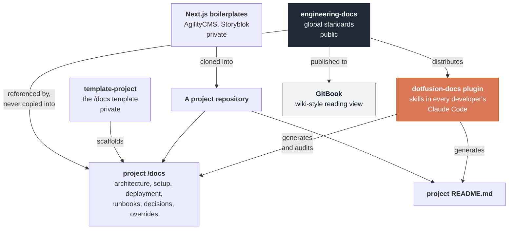

<div align="center">


# Engineering handbook

The engineering standards behind how Dotfusion builds software.
This repository is also the Claude Code marketplace that installs our skills into every developer's editor.

[](LICENSE)
[](https://github.com/Dotfusion/engineering-docs/actions/workflows/docs-check.yml)
[](#install-our-claude-code-skills)
[](https://github.com/Dotfusion/engineering-docs/commits/main)

[Install the skills](#install-our-claude-code-skills) &nbsp;&nbsp;·&nbsp;&nbsp; [Start here](start-here.md) &nbsp;&nbsp;·&nbsp;&nbsp; [The handbook](#the-handbook) &nbsp;&nbsp;·&nbsp;&nbsp; [For partners and clients](#for-partners-and-clients)

</div>

Dotfusion is a Toronto-based digital agency that builds websites on a headless content management system (CMS). This repository holds the engineering standards behind that work: how we write code, test it, ship it, secure it, make it accessible, and document it.

It has two readers. For our developers it is the handbook, and the source of the Claude Code skills that apply these standards during the work. For the partners and clients who build alongside us, it is the standard we can be held to, without having to ask us for it. Nothing here is specific to one client, which is why it can stay open.

All of it serves one purpose: documentation exists to reduce dependency on individual memory.

## Install our Claude Code skills

This repository doubles as a [Claude Code](https://claude.com/claude-code) plugin marketplace. The `dotfusion-docs` plugin distributes our skills to every developer's editor, so a developer applies the standards below while writing code instead of looking them up afterward. Because the marketplace is this repository, a commit to `main` publishes a new version, and each developer picks it up the next time Claude Code starts.

You do not install it by hand. The Dotfusion Claude organization installs the plugin, with auto-update on, once you sign in to Claude Code with your Dotfusion account and restart it. To confirm it, run `claude plugin list` and look for `dotfusion-docs@dotfusion`. If it is missing, install it from a Claude Code session:

```text
/plugin install dotfusion-docs --marketplace Dotfusion/engineering-docs
```

[Claude Code plugins setup](agents/PLUGIN-SETUP.md) covers the manual install for when that does not happen, how to check that all twelve skills loaded, how to remove a stale copy of a skill, and how to author skills locally.

### What the skills do

Find a skill by the task in front of you, not by its name.

| When you are | Use | What it does |
| --- | --- | --- |
| Starting your first week | [`onboarding`](agents/skills/onboarding/) | Verifies your accounts and toolchain, walks the required reading, gets your assigned project running, and finishes at your first merged pull request |
| About to write or change code | [`engineering-standards`](agents/skills/engineering-standards/) | Routes the task to the standard that governs it and names the rules that block a merge. Start here. |
| Setting up a freshly cloned project | [`finish-the-install-agility`](agents/skills/finish-the-install-agility/) [`finish-the-install-storyblok`](agents/skills/finish-the-install-storyblok/) | Completes per-project setup for the AgilityCMS or Storyblok boilerplate: environment variables, brand colors, fonts, metadata, then verifies it |
| About to open a pull request | [`pr-review`](agents/skills/pr-review/) | Reviews a diff against the handbook: the rules that block a merge, correctness, accessibility, secrets, tests, and whether docs changed with behavior |
| Documenting a repository | [`project-readme`](agents/skills/project-readme/) | Writes the root `README.md` from the actual codebase, asking about what it cannot determine |
| Setting up or auditing project docs | [`project-docs`](agents/skills/project-docs/) | Scaffolds `/docs`, fills it from the code, audits it for drift, and records architecture decisions |
| Writing any prose | [`writing-guidelines`](agents/skills/writing-guidelines/) | Reviews a document against our writing standard |
| Writing React or Next.js | [`react-best-practices`](agents/skills/react-best-practices/) | Performance rules for components, rendering, bundling, and data fetching |
| Writing or fixing tests | [`playwright-best-practices`](agents/skills/playwright-best-practices/) | Patterns for writing, structuring, and debugging Playwright tests |
| Exploring a page or generating a test | [`playwright-cli`](agents/skills/playwright-cli/) | Spec-driven test generation and live page inspection |
| Improving accessibility | [`accessibility`](agents/skills/accessibility/) | Audits against WCAG and proposes fixes |

## The handbook

Every standard, grouped by what you are doing. If you are new, [Start here](start-here.md) routes you by situation instead.

### Before you write code

- [Engineering principles](engineering/engineering-principles.md). The five ideas the rest of this handbook follows from.
- [Code standards](development/code-standards.md). Naming, comments, configuration, dependency hygiene, and error handling.
- [Architecture Decision Records](engineering/architecture-decision-records.md). When a decision needs recording, where it lives, and the template.
- [Boilerplates and templates](engineering/boilerplates-and-templates.md). Which repository a new project starts from, and what finishes the setup.
- [Glossary](engineering/glossary.md). Every term and acronym used across this handbook.

### While you build

- [Development workflow](development/development-workflow.md). Branching, pull requests, and what a reviewer looks for.
- [Testing strategy](quality/testing-strategy.md). What to test, and how much confidence each level buys.
- [Testing types](quality/testing/testing-types.md). The twelve types we use, with the cost and the payoff of each.
- [Playwright end-to-end testing](quality/testing/e2e-testing.md). Configuration, folder layout, authentication, mocking, and CI.
- [Accessibility](accessibility/accessibility.md). Why we follow the Accessibility for Ontarians with Disabilities Act (AODA), why our target is Web Content Accessibility Guidelines (WCAG) 2.1 AA, and the toolchain.
- [Manual testing checklist](accessibility/manual-testing-checklist.md). The hands-on accessibility pass before sign-off.
- [Performance](quality/performance.md). Core Web Vitals targets, where they are enforced, and the practices that meet them.

### Handling secrets and data

- [How to manage .env files](security/how-to-manage-env.md). 1Password, `op run`, and why `NEXT_PUBLIC_` is a one-way door.
- [Security guidelines](security/security-guidelines.md). The baseline every project follows, and what belongs in private docs.
- [Code security scanning](security/code-security-scanning.md). Semgrep as a pull request gate, and what it costs.
- [Data handling and privacy](security/data-and-privacy.md). Collecting less, keeping it out of logs, and what to do when it leaks.

### Shipping and running it

- [CI/CD](delivery/ci-cd.md). Continuous integration and delivery: the pull request pipeline, environments, deploy triggers, and rollback.
- [Observability and monitoring](observability/monitoring.md). Answering "is it healthy?" and "what went wrong?" without guessing.
- [Incident response](delivery/incident-response.md). Severity levels, who leads, the order of operations, and the postmortem.

### Documenting it

- [Documenting your work](development/documenting-your-work.md). What to write at each point in the work, and which skill to invoke for it.
- [Documentation standards](agents/documentation-standards.md). What a project must document, and how documentation stays alive.
- [AGENTS.md](agents/AGENTS.md). The canonical writing standard, for people and for AI agents.
- [Claude Code plugins setup](agents/PLUGIN-SETUP.md). Installing, updating, and authoring the skills.
- [Contributing](CONTRIBUTING.md). How to propose a change to any of this.

### How the team works

- [Developer onboarding](process/developer-onboarding.md). A new developer's first week: the accounts they need and who grants each, the tools, the required reading, and where onboarding ends.
- [Team working model](process/team-working-model.md). Roles, asynchronous collaboration across time zones, and handoffs.
- [Design handoff](process/design-handoff.md). What engineering needs from a design before build starts.

## How our documentation is organized

We use two levels, and we do not blur them.

1. **Global documentation.** Shared standards, principles, workflows, and conventions. This repository. When something changes for everyone, it changes here.
2. **Project documentation.** The reality of one project: architecture, setup, deployment, integrations, runbooks, decisions, and exceptions. The `/docs` folder in each project repository, with a `README.md` at its root.

Project documentation references these standards rather than copying them, and documents only what is different for that project. A copied standard stops tracking the original the moment either one changes, and nobody finds out until the two disagree.



Every standard here follows the same shape, so the collection reads as one handbook rather than a folder of memos:

1. A short statement of purpose.
2. The current standard, described concretely.
3. Where the boundary sits between this global default and project-specific reality.
4. A `Related` section linking the neighboring documents.

GitBook publishes these documents as a wiki-style reading view for the team. The repository stays the source of truth, because that is where review, automated checks, and the plugin live.

## What never goes in this repository

This repository is public. Publishing a standard costs nothing. Publishing the details of one client's system costs that client.

Never add:

- client-specific information
- credentials, secrets, tokens, or environment values
- private URLs, infrastructure identifiers, or architecture details
- incident detail that exposes a vulnerability
- personal data
- commercial or contractual information

If something applies to one client or one project, it belongs in that project's private repository. No automated check can catch this, which is why it is the reviewer's job.

## For partners and clients

This handbook is public, and you are welcome to hold us to it.

- **Why it is public.** These standards describe how we work, not what we know about your business. A client, a partner agency, or a developer joining a shared project can read them without asking.
- **What it commits us to.** These are our defaults. Where a project departs from one, the exception is recorded in that project's own documentation with its reason.
- **Working on a shared codebase with us.** These are the conventions we follow and the ones we raise in review. [Start here](start-here.md) has a route for you. [`engineering-standards`](agents/skills/engineering-standards/) states the rules that block a merge.
- **Reusing this.** It is MIT licensed, so you can fork it and adapt it. Attribution is appreciated and not required.
- **Reporting a mistake.** [Open an issue](https://github.com/Dotfusion/engineering-docs/issues/new/choose). Corrections from outside the team are welcome. For anything commercial, or to report a security concern privately, reach us through [dotfusion.com](https://www.dotfusion.com) instead of a public issue.

## Contributing

Changes to a global standard go through a pull request, get reviewed, and pass the automated checks, for the same reason we require it of project code. [CONTRIBUTING.md](CONTRIBUTING.md) covers how to propose one, and [AGENTS.md](agents/AGENTS.md) is the writing standard every document is held to.

## License

MIT. See [LICENSE](LICENSE), which also lists the third-party skills vendored under their own licenses.

<div align="center">

Built by [Dotfusion](https://www.dotfusion.com) in Toronto, Ontario, Canada 🇨🇦