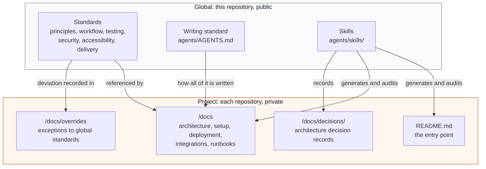

# Documentation standards

This document defines what documentation has to exist, how it is structured, and why. It is the model.

For what you personally do about documentation during a piece of work, and which skill to invoke at each point, read [Documenting your work](../development/documenting-your-work.md). This document is the what. That one is the when.

## Core rule

Documentation should explain what someone needs to know to work safely and independently.

## Global vs project documentation

Global documentation describes standards used across our projects.

Project documentation describes the reality of one project.

Project documentation should not copy global standards. It should reference them and explain differences.



The arrow that matters is the one from global standards to project docs: it points one way, and it says "referenced by" rather than "copied into". A copied standard stops tracking the original the moment either one changes.

## Project README

Every project repository has a `README.md` at its root as the entry point for
anyone joining the project. It is generated and kept current with the
`project-readme` Claude Code skill (in this repo under
`agents/skills/project-readme/`), which is the **source of truth** for README
structure and our documentation conventions, including the link back to these
global docs.

This document explains the *why*; the skill encodes the *how*. When a README
convention changes, change it in the skill. Always read and verify generated
output before committing.

See [Claude Code plugins setup](PLUGIN-SETUP.md) for how the skill reaches
the team.

## Required sections for project docs

Each project should have:

- overview
- business and product context references
- architecture
- local setup
- deployment
- integrations
- runbooks
- decisions
- overrides to global standards

## Unknowns

If something is unknown, write it clearly.

Do not hide uncertainty.

Use:

```text
Unknown: The rollback process has not been confirmed yet.
```

## Keeping docs alive

Documentation is updated in the same pull request as the change that made it wrong. [Documenting your work](../development/documenting-your-work.md) maps each trigger below to the file it affects and the skill that writes it.

Documentation should be updated when:

- behavior changes
- setup changes
- deployment changes
- architecture changes
- a new integration is added
- a decision is made
- a recurring issue is discovered

## Related

- [Documenting your work](../development/documenting-your-work.md)
- [AGENTS.md](AGENTS.md)
- [Claude Code plugins setup](PLUGIN-SETUP.md)
- [Engineering principles](../engineering/engineering-principles.md)
- [Architecture Decision Records](../engineering/architecture-decision-records.md)
- [Boilerplates and templates](../engineering/boilerplates-and-templates.md)
- [Glossary](../engineering/glossary.md)
- [Contributing](../CONTRIBUTING.md)
