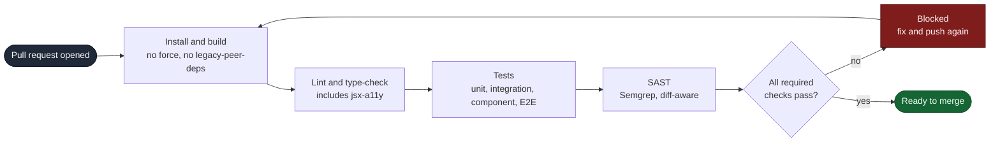

# CI/CD

This document describes the default delivery standard: how code moves from a pull request to production safely and repeatably.

These are global defaults. Project-specific deployment details (provider, build commands, environment configuration) belong in each project repository, because this repository is public.

## Principles

Continuous integration and continuous delivery exist to make releases safer, more repeatable, and less dependent on individual memory.

- **Every change runs the same checks.** A pull request is verified by automation, not by whoever happens to review it.
- **The pipeline is the source of truth for "ready to merge."** If the checks pass, the change is safe to merge by definition. If they do not catch a class of problem, the fix is to improve the checks, not to rely on manual vigilance.
- **Deployments are boring.** A deploy should be a routine, reversible event, not a high-stakes manual operation.
- **Small, frequent changes over large, infrequent ones.** This aligns with [Prefer small, reversible changes](../engineering/engineering-principles.md).

## Continuous integration: the pull request pipeline

Every pull request should run an automated pipeline before it can merge. The default stages, in order of cost:

1. **Install and build.** Dependencies install cleanly (no `--force` or `--legacy-peer-deps`, per [Code standards](../development/code-standards.md)) and the project builds.
2. **Lint and type-check.** Static analysis, formatting, and type checks run and must pass. This includes `eslint-plugin-jsx-a11y` where applicable (see [Accessibility](../accessibility/accessibility.md)).
3. **Tests.** The project's unit, integration, and component tests run. End-to-end and smoke tests run on pull request and on the main branch (see [Testing strategy](../quality/testing-strategy.md) and [Testing types](../quality/testing/testing-types.md)).
4. **Security scanning.** Static application security testing runs on every pull request and fails the build on high or critical findings (see [Code security scanning](../security/code-security-scanning.md)).

A pull request that fails any required check does not merge. Required checks should be enforced as branch protection rules, not left to convention.

The stages are ordered by cost, so the cheapest check fails first. A build that will not install does not need to wait on an end-to-end suite to tell you so.

## Environments

Most of our projects use three logical environments:

- **Preview.** An ephemeral environment created per pull request (Vercel and Netlify provide this automatically). Used to review and test a change in isolation before merge.
- **Staging.** A stable, production-like environment for integration testing, client review, and acceptance testing where a project needs one.
- **Production.** The live environment serving real users.

Not every project needs a dedicated staging environment. Preview environments cover much of the same need for smaller projects. Each project documents which environments it actually has.

```mermaid
flowchart LR
    B["Feature branch"] -->|"push"| PRV["<b>Preview</b><br/>one per pull request<br/>ephemeral"]
    PRV -->|"review and approve"| MAIN["main"]
    MAIN -->|"merge<br/>(automatic)"| STG["<b>Staging</b><br/>where a project has one<br/>client review, UAT"]
    STG -->|"promote<br/>(gated where the client<br/>reviews each release)"| PROD["<b>Production</b>"]
    PROD -.->|"platform rollback"| LKG["Last known-good build"]
    LKG -.->|"promote"| PROD

    style PRV fill:#f3f4f6,stroke:#9ca3af,color:#111827
    style STG fill:#fef3c7,stroke:#d97706,color:#111827
    style PROD fill:#166534,stroke:#14532d,color:#f0fdf4
    style LKG fill:#f3f4f6,stroke:#9ca3af,color:#111827
```

The deploy trigger for each arrow is a project decision, and stating it explicitly is what stops a surprise deploy.

## Deployment

- **Define the trigger explicitly.** State what causes a deploy to each environment (for example, merging to `main` deploys to production). Avoid surprise deploys.
- **Gate production where the client requires it.** When a client reviews each release, production deploys require manual approval. Document this as an override, with the reason, in the project repository.
- **Make success verifiable.** After a deploy, it must be possible to confirm the system is healthy (see [Observability and monitoring](../observability/monitoring.md)). Run smoke tests against the deployed environment where they exist.
- **Keep secrets out of the pipeline config.** CI secrets are injected from the platform's secret store or from 1Password, never committed (see [How to manage .env files](../security/how-to-manage-env.md)).

## Rollback

Every live project must have a known, documented way to undo a bad release. A deploy is not safe if it cannot be reversed.

- Prefer platform-native rollback (Vercel and Netlify keep previous deployments and allow instant promotion of a known-good build).
- Know how database or data migrations affect rollback. A schema change that is not backward compatible can make a rollback unsafe; plan migrations so the previous release still runs.
- The rollback steps must be written down, not improvised during an incident.

## Hosting platforms

Common hosting providers across our projects:

- Vercel
- Netlify
- Amazon Web Services

Project documentation must clearly identify where each project is hosted and how its pipeline is configured.

## Minimum project documentation

A project is not properly documented until a developer can answer:

- how does this build and deploy, and what triggers each deploy?
- which environments exist (preview, staging, production)?
- how do I know a deployment succeeded?
- how do I roll back, and are there migration constraints on rolling back?
- what environment variables are required, and where do they come from?
- where do build and runtime logs live?
- what production access is required, and who has it?

## Related

- [Observability and monitoring](../observability/monitoring.md)
- [Incident response](incident-response.md)
- [Performance](../quality/performance.md)
- [Code security scanning](../security/code-security-scanning.md)
- [How to manage .env files](../security/how-to-manage-env.md)
- [Testing strategy](../quality/testing-strategy.md)
- [Development workflow](../development/development-workflow.md)
